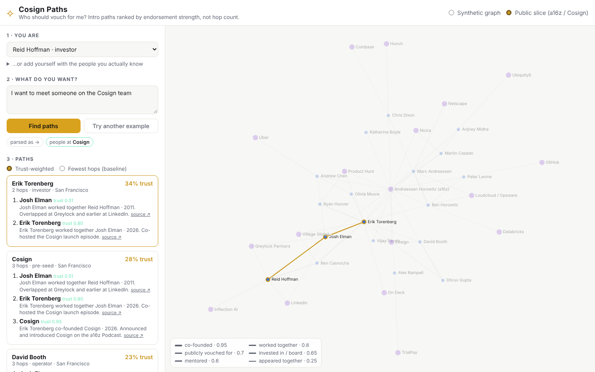

# Cosign Paths

**Who should vouch for me?** A small demo that finds intro paths over an *endorsement* graph and ranks them by how much trust each hop carries, not by how few hops there are.

No backend, no build step, no API keys. Open `index.html` and it runs.



## Why this exists

Professional networks answer "who do I know?" Cosign's premise is that the better question is "who would vouch for me, and how strongly?" A co-founder's word is not the same as a conference handshake, and an endorsement from 2015 is not the same as one from last quarter.

This demo takes that premise seriously and asks what a *warm-intro finder* looks like when the edges are endorsements instead of connections:

| Plain connections graph | Endorsement graph (this demo) |
|---|---|
| Shortest path = fewest hops | Best path = highest product of edge trust, discounted per hop |
| Every edge counts the same | Edge weight = endorsement type × recency |
| "You have 3 mutual connections" | "Teo worked with you for three years and co-founded Vector with Kai" |
| Path is a fact | Path is an argument, with a source on every hop |

Flip the **Fewest hops (baseline)** toggle to see the difference on the same query. The baseline happily routes you through "met at a founder dinner in 2019"; the trust-weighted path takes one more hop through people who have actually worked together.

## What it does

1. **You are** – pick a node, or add yourself with 1–3 people you really know and how you know them. That is the whole onboarding: the graph grows from endorsements you assert, which is also how Cosign's waitlist works.
2. **What do you want?** – a sentence. A small rule-based parser pulls out skills, role, stage, city, and any named person or company (`"someone on the Cosign team"` → people with a `worked_with`/`cofounded` edge to Cosign). Swap in an LLM if you like; the interface is one function.
3. **Paths** – Dijkstra on `-log(trust)` from you to every candidate, top 3 by `trust × fit`. Each hop shows the endorsement type, year, the reason text, and a source link.
4. **Ask for the intro** – a draft note to the first *person* on the path (never a company), that quotes the reason they would remember you and names who you want to reach.

### Trust model

```
edge_trust(e)  = base[e.type] × recency(e.year)
recency(y)     = 0.6 + 0.4 · exp(−(2026 − y) / 6)
path_trust     = ∏ edge_trust(e) × 0.85^(hops − 1)
```

Default priors (editable in each dataset's `edgeTypes`):

| type | base | reads as |
|---|---|---|
| `cofounded` | 0.95 | co-founded |
| `worked_with` | 0.80 | worked together |
| `cosigned_skill` | 0.70 | publicly vouched for a skill |
| `invested_in` | 0.65 | invested in / board |
| `mentored` | 0.60 | mentored |
| `met_at_event` | 0.25 | appeared together / met once |

Walking a directed endorsement backwards (asking the person who *received* the cosign to reach the one who gave it) costs a 0.8 penalty. `worked_with` and `cofounded` are symmetric.

## Data

Two datasets, switchable in the header.

**Synthetic graph** (`data/synthetic.js`, 260 nodes / ~1,600 edges). Generated by `scripts/generate_synthetic.py`. Every person, company and endorsement is invented; names come from a word list so nothing collides with a real public figure. Regenerate with a different seed:

```bash
python3 scripts/generate_synthetic.py --seed 7 --people 300
```

**Public slice** (`data/public.js`, ~35 nodes). A hand-curated neighbourhood around a16z and Cosign, built only from public bios, Wikipedia and press. Every edge cites the page it came from and carries `verified: false` until a human re-checks it. It is small on purpose: the point is to show the same logic reading naturally on relationships people recognise, not coverage.

What is deliberately **not** here: anything scraped from Cosign, LinkedIn or any other network; private contact details; inferred relationships.

## Run

```bash
git clone https://github.com/BlairLee/cosign-warm-paths
cd cosign-warm-paths
open index.html          # or: python3 -m http.server 8000
```

D3 is vendored in `vendor/` so the page works offline and from `file://`.

## Plugging in a real graph

`app.js` only needs `{ nodes, edges, edgeTypes }`. A node is `{id, kind: "person"|"company", name, role|stage, skills|focus, city}`; an edge is `{source, target, type, year, reason, src?}`. Point `window.COSIGN_PUBLIC` at an export of real endorsements and nothing else changes.

## Built with

Claude Code, over one evening. The agent transcript is in `docs/transcript.md`.

## License

MIT. D3 is BSD-3 (see `vendor/d3.LICENSE`).
